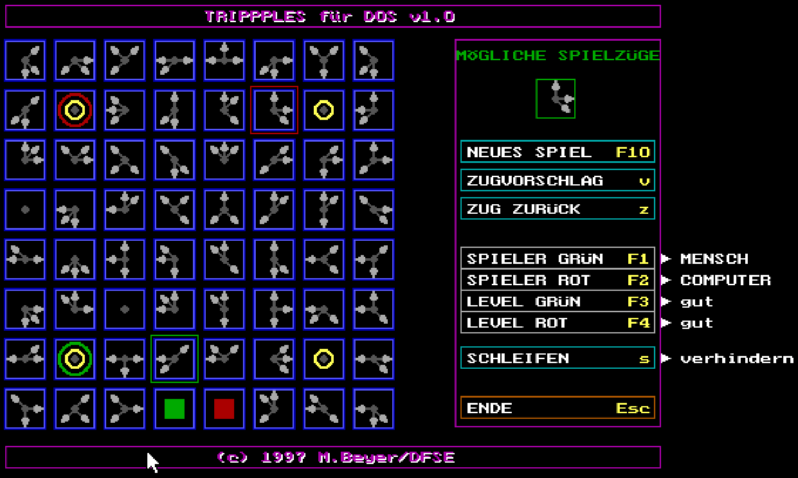

# TRIP for DOS — The Original 1997 Implementation

**TRIP** is my original DOS implementation of *Trippples*, an abstract strategy board game designed by William T. Powers in the early 1970s.

I discovered the game in 1997 through Paul Kienitz's Amiga implementation, written in C. Inspired by it, I created my own DOS version using Turbo Pascal 7.0.

Almost thirty years later, while sorting through old documents, I stumbled upon a printed copy of the original Pascal source code. This unexpected rediscovery brought the project back to life and eventually inspired me to revisit Trippples with modern development tools.

This repository preserves the original DOS program and its source code as a small piece of personal software development history.

## Why Revisit It?

The rediscovery of the Pascal source led to a larger project: **[Trippples — An Abstract Strategy Game Revisited](https://github.com/mgbeyer/trippples)**.

The modernization project aims to reconstruct and document the game's rules, build a modular and testable implementation, and eventually bring the game to modern platforms, potentially including Android and online multiplayer.

The original DOS version is an important reference for this work. It provides an opportunity to revisit my own implementation, examine its gameplay and AI, and compare design decisions made almost three decades apart.

## About the Original Program

- Developed in **Turbo Pascal 7.0** in 1997.
- Runs under MS-DOS.
- Supports EGA (640 × 350) and VGA (640 × 480) graphics modes.
- Supports keyboard and mouse input.
- Offers human and computer-controlled players.
- Includes several AI difficulty levels, a move suggestion feature, and move undo functionality.
- Uses a custom-developed keyboard unit (`MFII`) for extended keyboard handling and direct BIOS/hardware access.

The original program was distributed as shareware.

## Documentation

The original German documentation has been preserved and linguistically cleaned up:

**[Original German Documentation (DOKUMENTATION.md)](DOKUMENTATION.md)**

## A Note on the Code

The source code is presented largely as it was written in 1997. It is a historical snapshot, not a modernized or refactored codebase. Some of its implementation choices reflect the constraints and programming practices of the DOS era.

And, as I admitted in the original documentation:

*The source code is a complete disaster. To this day, I still haven't figured out why it manages to survive a compiler run.*

Apparently, some things are better left untouched. :-)

---

**Related project:** [Trippples — An Abstract Strategy Game Revisited](https://github.com/mgbeyer/trippples)

*An independent project inspired by the historical board game Trippples. Not affiliated with its original designer or publishers.*